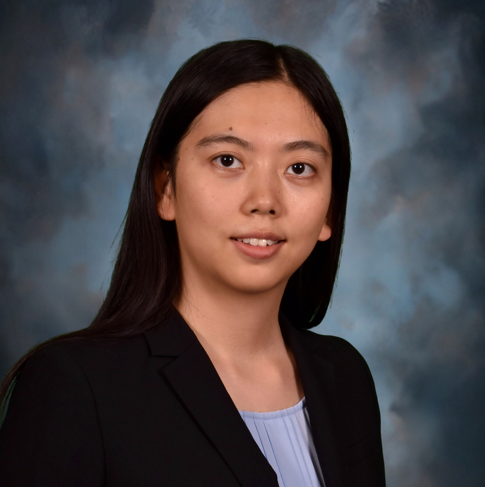

# Towards Effective and Efficient Multi-Agent Language Model Systems: Foundations, Prospects, and Applications

[Yi Fang](https://yifang99.github.io/)1, [Yu Zhang](https://yuz9yuz.github.io/)1, [Xuan Wang](https://xuanwang91.github.io/)1

1,3Virginia Tech, 2Texas A&M

Time: **December 9, 2026, Time TBD**

Location: **Atlanta, GA @ Georgia World Congress Center, Room TBD**

## Abstract:
Research on multi-agent communication has fragmented into three paradigms that evolved in isolation: Multi-Agent Reinforcement Learning (MARL), Emergent Language (EL), and LLM-based agents. This tutorial presents a unified science of multi-agent communication spanning all three. We model communication as a state-perturbation operator on the receiver’s state, derive from it a Format × Content taxonomy (Sensory, Symbolic, Latent, and Parameter formats crossed with Facts, Self-state, Intent, and Control content), introduce the Communication Pentagram for task-independent channel evaluation (Bandwidth, Computational Cost, Robustness, Generalization, Interpretability), and distill cross-paradigm design principles with a transfer principle for porting techniques between paradigms. The tutorial equips a broad NeurIPS audience with a common mathematical ground, a working taxonomy, and a roadmap for designing, evaluating, and securing the communication layer of agent systems.

## Tutorial Recording:
A recording of our tutorial will be released after the conference.

## Slides:
- Introduction \[[Slides]()]
- Part I: Unified Science of Multi-Agent Communication \[[Slides]()]
- Part II: LLM-Based Multi-Agent Communication \[[Slides]()]
- Part IV: Summary: Evaluation and Reliability \[[Slides]()]

## Presenters: 

|-------------|-------------|
|-------------|-------------|
|  | **Yi Fang** is a Ph.D. student in Computer Science at Virginia Tech, advised by Dr. Xuan Wang, and the lead author of the [comprehensive survey of multi-agent communication](https://yifang99.github.io/Towards-The-Science-of-Agent-Communication/) on which this tutorial is based (currently under review). His research focuses on multi-agent systems and inter-agent communication across reinforcement learning and LLM-based agents. |
|-------------|-------------|
|  | **Yu Zhang** is an Assistant Professor of Computer Science and Engineering at Texas A&M University. He received his Ph.D. from the University of Illinois Urbana-Champaign, advised by Prof. Jiawei Han; his dissertation received the ACM SIGKDD Dissertation Award Runner-Up in 2025. His research focuses on LLM agents for scientific research and LLM agents with structural knowledge. He serves as a Senior Area Chair for ACL and EMNLP and an Area Chair for KDD and NeurIPS, and has delivered four conference tutorials, most recently at WSDM 2026. |
|  | **Xuan Wang** is an Assistant Professor in the Department of Computer Science at Virginia Tech. Her research interests are in natural language processing, data mining, AI for sciences, and AI for healthcare. Xuan was a recipient of the NSF CAEER Award 2025, Cisco Research Award 2025, NSF NAIRR Pilot Award 2024-2025, and NAACL Best Demo Paper Award 2021. Xuan has served as a Program Chair of the SouthNLP Symposium 2024 (>150 participants), from more than 20 universities across the USA. She has also served as a Program Chair for the Undergraduate and High School Symposium at IEEEBigData 2024 and IEEE-ICDM 2025. She has also served as a Senior Area Chair, Area Chair, and Program Committee in major AI conferences (e.g., ARR, ACL, EMNLP, NAACL, NeurIPS, ICLR, KDD). Xuan has delivered tutorials in ACL 2026, AAAI 2025, EMNLP 2024, KDD 2022, TheWebConf 2022, and IEEE-BigData 2019. |

